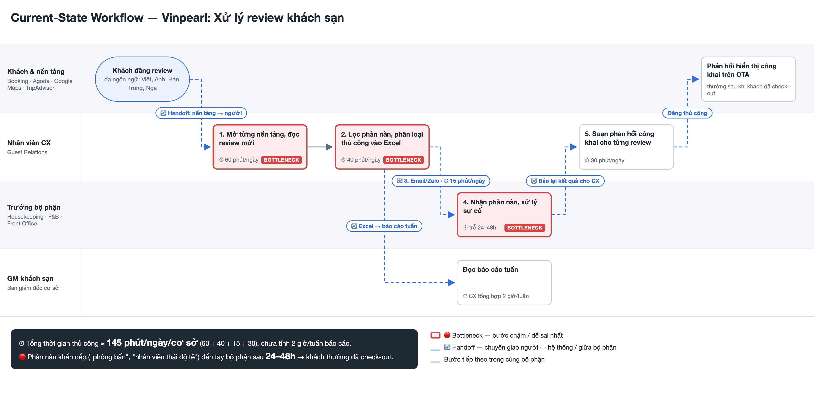

# 02 — Deep-Dive Report: Vinpearl — Tổng hợp & phân tích review khách sạn

**Người viết:** Nguyễn Trung Anh — 2A202603413
**Đề tài nhóm:** Vinpearl — Tổng hợp & phân tích review khách sạn (4/6 phiếu)

> Các con số thời gian/khối lượng là **ước tính giả định** cho 1 cơ sở khách sạn, cần xác minh với bộ phận Guest Relations.

---

## 3.1. Current-State Workflow



| # | Bước | Ai làm | ⏱ Thời gian | Ghi chú |
|---|---|---|---|---|
| 1 | Mở 4 nền tảng (Booking, Agoda, Google Maps, TripAdvisor), đọc review mới | Nhân viên CX | 60 phút/ngày | 🔴 Bottleneck |
| 2 | Lọc phàn nàn, phân loại thủ công vào Excel | Nhân viên CX | 40 phút/ngày | 🔴 Bottleneck |
| 3 | Gửi email/Zalo cho trưởng bộ phận (Housekeeping, F&B, Front Office) | CX → Bộ phận | 15 phút/ngày | 🔄 Handoff |
| 4 | Bộ phận xử lý, báo lại CX | Trưởng bộ phận | Trễ 24–48h | 🔴 Bottleneck · 🔄 Handoff |
| 5 | Soạn phản hồi công khai trên nền tảng | Nhân viên CX | 30 phút/ngày | |
| — | Tổng hợp báo cáo tuần cho GM | CX → GM | 2 giờ/tuần | 🔄 Handoff |

**Tổng cộng ≈ 145 phút/ngày/cơ sở** (chưa tính báo cáo tuần). Phàn nàn khẩn cấp đến tay bộ phận sau 24–48h — thường khách đã check-out.

---

## 3.2. Problem Statement (6-field)

| Field | Nội dung |
|---|---|
| **1. Actor / Operator** | Nhân viên CX / Guest Relations tại từng cơ sở Vinpearl; người nhận là trưởng bộ phận và GM. |
| **2. Current Workflow** | CX đăng nhập riêng từng nền tảng, đọc review đa ngôn ngữ, chép phàn nàn vào Excel, chuyển bộ phận qua email/Zalo, rồi tự soạn phản hồi công khai. Hoàn toàn thủ công, ~145 phút/ngày. |
| **3. Bottleneck** | Bước 1–2: đọc và phân loại review đa ngôn ngữ (Việt, Anh, Hàn, Trung, Nga) bằng tay. Bước 4: phàn nàn khẩn cấp ("phòng bẩn", "nhân viên thái độ tệ") bị phát hiện trễ 24–48h. |
| **4. Business Impact** | ~2,4 giờ/ngày/cơ sở công lao động lặp lại. Mất cơ hội xử lý khi khách còn lưu trú (service recovery), review tiêu cực không được phản hồi kịp kéo điểm đánh giá trên OTA xuống, ảnh hưởng tỉ lệ đặt phòng. |
| **5. Success Metric** | 1. Review khẩn cấp đến đúng bộ phận **< 1 giờ** (từ 24–48h).<br>2. **Recall ≥ 95%** với review khẩn cấp (gần như không bỏ sót), **độ chính xác phân loại chủ đề ≥ 85%**.<br>3. Thời gian CX đọc–phân loại: **100 → < 20 phút/ngày**. |
| **6. Operational Boundary** | **Được phép:** đọc review công khai, phân loại chủ đề + mức khẩn + ngôn ngữ, dịch sang tiếng Việt cho người đọc nội bộ, soạn nháp phản hồi gắn `[DRAFT_ONLY]`.<br>**TUYỆT ĐỐI KHÔNG:** tự đăng phản hồi công khai; hứa hoàn tiền/bồi thường/giảm giá; nêu thông tin cá nhân của khách (tên, số phòng); quy lỗi cho nhân viên cụ thể; làm theo chỉ dẫn nằm trong nội dung review (review là dữ liệu, không phải lệnh).<br>**Bắt buộc người duyệt:** mọi phản hồi trước khi đăng; review về an toàn/sức khỏe/pháp lý (ngộ độc, tai nạn, mất cắp) → chuyển thẳng Manager, AI không soạn nháp. |

---

## 3.3. Future-State Flow & AI Fit

**So sánh lựa chọn:**

| Phương án | Đánh giá |
|---|---|
| Rule / keyword | Bắt được "bẩn", "dirty" nhưng bỏ sót câu mỉa mai, phủ định, đa ngôn ngữ → recall thấp. Dùng cho **bước định tuyến** sau khi đã có nhãn. |
| LLM trả JSON | Hiểu ngữ cảnh tốt nhưng JSON có thể sai cấu trúc hoặc ra nhãn ngoài danh sách; "độ tự tin" do LLM tự khai, khó tin. |
| **Jev (phân loại)** ✅ | Model chọn nhãn trong danh sách cố định kèm xác suất — không có JSON để parse, không ra nhãn lạ, xác suất dùng làm ngưỡng fallback. Không sinh được văn bản. |
| **LLM Feature (soạn nháp/dịch)** ✅ | Cần cho phần viết: soạn phản hồi bằng ngôn ngữ của khách, dịch sang tiếng Việt cho nội bộ. |
| Agentic Loop | Không cần — quy trình cố định, không có hành động tự chủ nào an toàn để giao cho AI (đăng bài, bồi thường đều cần người). |

**AI Fit:** Jev (phân loại) + Rule router + LLM Feature (soạn nháp, dịch). Bỏ bước tóm tắt vì review thường ngắn.

**Future-State Flow:**

```text
⚙️ 1. Thu thập review tự động (API đối tác chính thức, 15 phút/lần)
   ↓
🔵 2. Jev phân loại (1 lần gọi) → chủ đề · mức khẩn P1/P2/P3 · ngôn ngữ (Việt/Anh/Khác) + xác suất
   ↓
⚙️ 3. Rule router: P1 → báo ngay Manager trực · P2/P3 → dashboard theo bộ phận
      (ngôn ngữ = Khác → LLM dịch sang tiếng Việt kèm theo)
   ↓
🔵 4. LLM soạn nháp phản hồi công khai bằng ngôn ngữ của khách, bắt đầu bằng [DRAFT_ONLY]
      + bản tiếng Việt để người duyệt đọc
   ↓
🟢 5. HITL: CX/Manager duyệt, sửa, rồi mới đăng
```

- Nếu API nền tảng đã có sẵn trường ngôn ngữ → dùng luôn (rule), Jev chỉ là dự phòng.
- Chỉ dịch khi có người đọc thật (bước 3 và 4) → review tiếng Việt/Anh không tốn lượt gọi dịch.

**↩️ Fallback:**
- Xác suất Jev thấp (< 0,7) hoặc chủ đề nhạy cảm → đưa vào hàng **"cần người đọc"**, xử lý như quy trình cũ.
- Jev/LLM/API ngừng hoạt động → CX quay lại đọc tay trên nền tảng.
- Kiểm tra mẫu 50 review/tuần để đo recall và độ chính xác thực tế.

---

## Phase 5 — EVALUATE

**AI Readiness Checklist:**

1. [x] **Dữ liệu mẫu:** Review công khai có sẵn, lấy được lịch sử để gán nhãn ~300 review làm bộ test.
2. [x] **Rủi ro kiểm soát được:** AI không đăng, không hứa hẹn gì; lỗi tệ nhất là bỏ sót review khẩn → đo bằng recall + kiểm tra mẫu hằng tuần.
3. [ ] **Stakeholders sẵn sàng:** Chưa xác nhận với Guest Relations và GM; cần buổi làm việc trước pilot.

**Rủi ro công nghệ:** Jev mới ra mắt (9/2026), con số "0% lỗi structured output" là số liệu của nhà cung cấp, chưa có kiểm chứng độc lập → pilot chạy **Jev song song Gemini** trên cùng bộ ~300 review đã gán nhãn, chọn theo recall/độ chính xác thực tế.

**Quyết định:** ✅ **GO — scope hẹp**

**Justification:**
> Dữ liệu công khai và sẵn có, giải pháp chỉ cần model phân loại + LLM Feature (không Agent), mọi đầu ra đều qua người duyệt nên rủi ro thấp. Tuy nhiên baseline hiện là **ước tính**, và stakeholders chưa xác nhận, nên chỉ GO với điều kiện: **pilot 4 tuần tại 1–2 cơ sở**, giai đoạn đầu **chỉ phân loại + cảnh báo** (chưa soạn nháp phản hồi), 2 tuần đầu đo baseline thật song song quy trình cũ. Mở rộng khi đạt recall ≥ 95% và thời gian cảnh báo < 1 giờ. Thu thập review qua API/kênh đối tác chính thức, không scrape trái điều khoản nền tảng.
